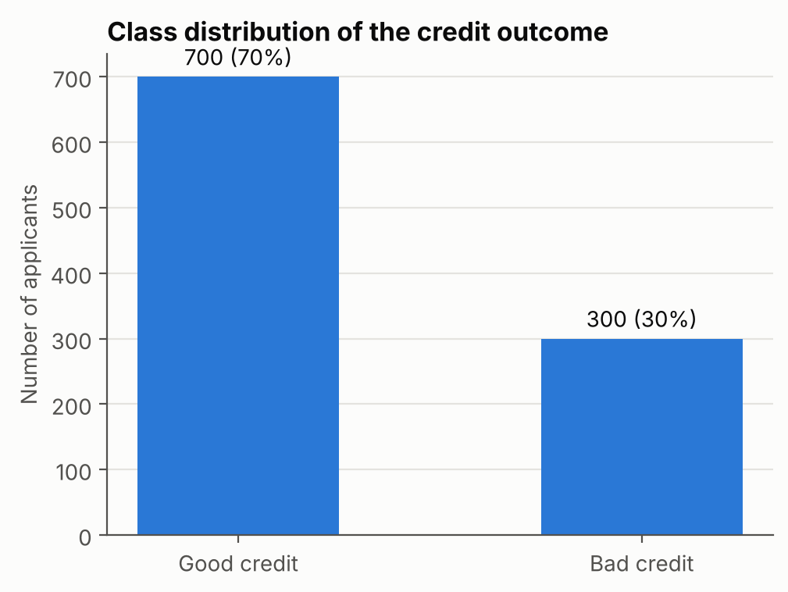
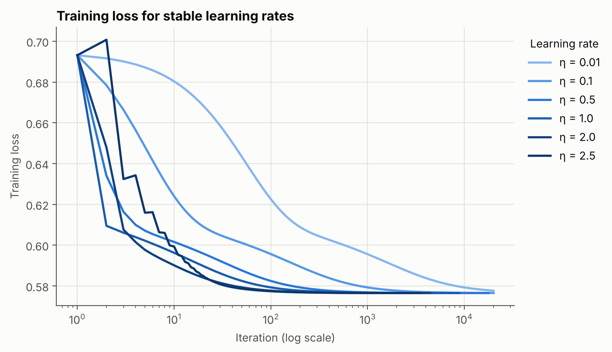
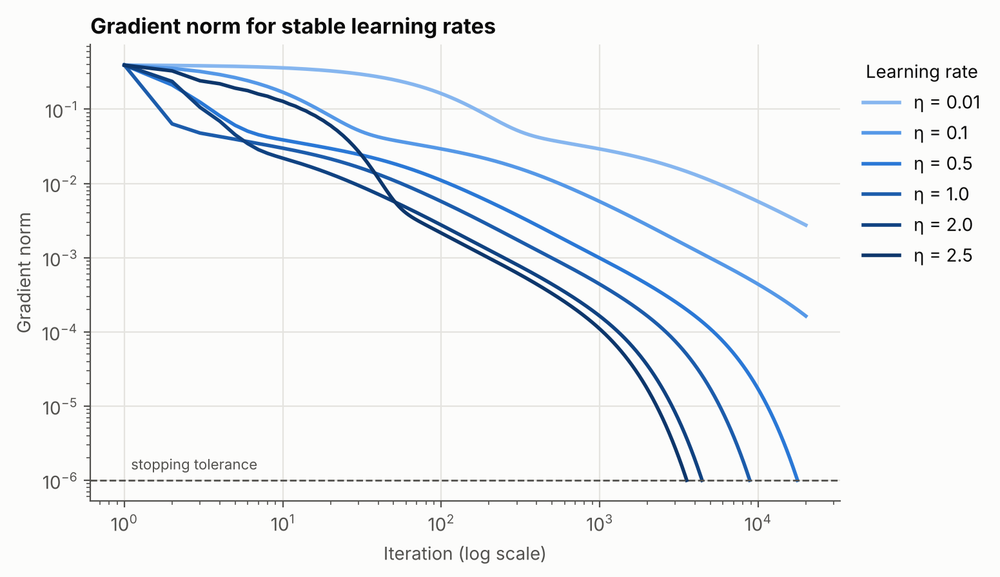
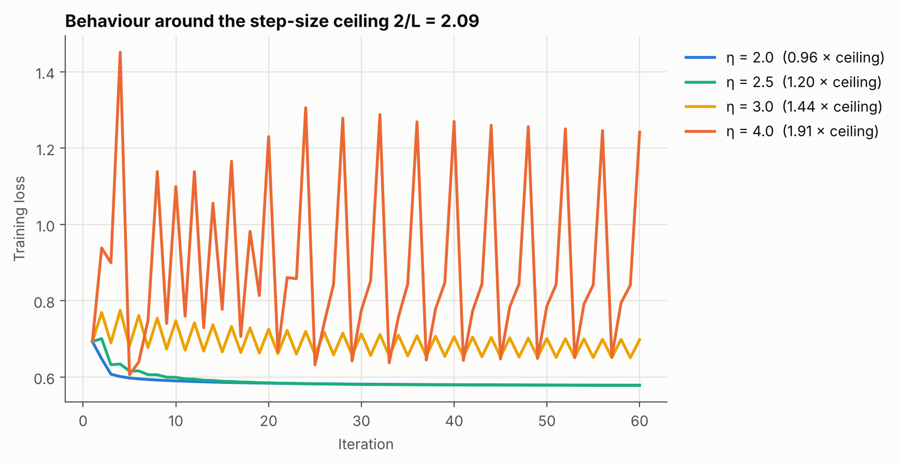
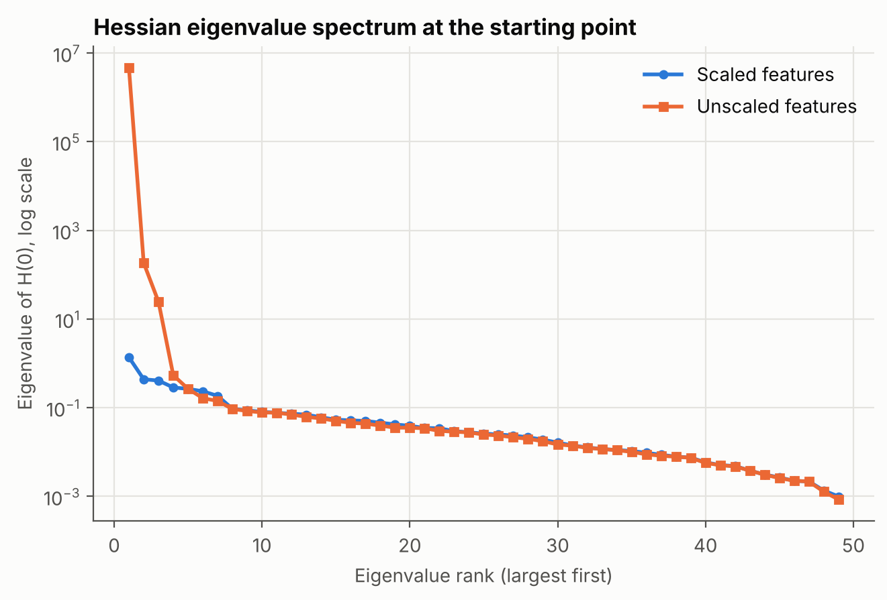
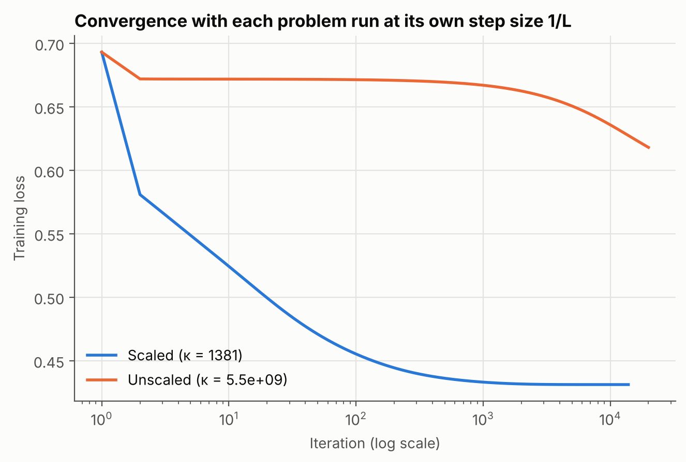
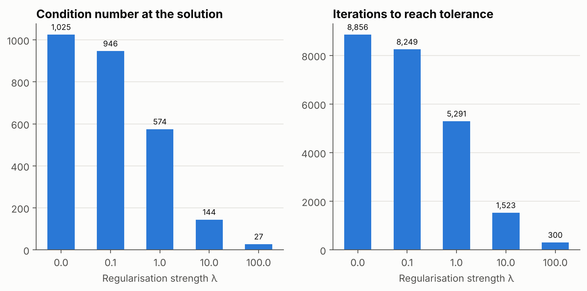
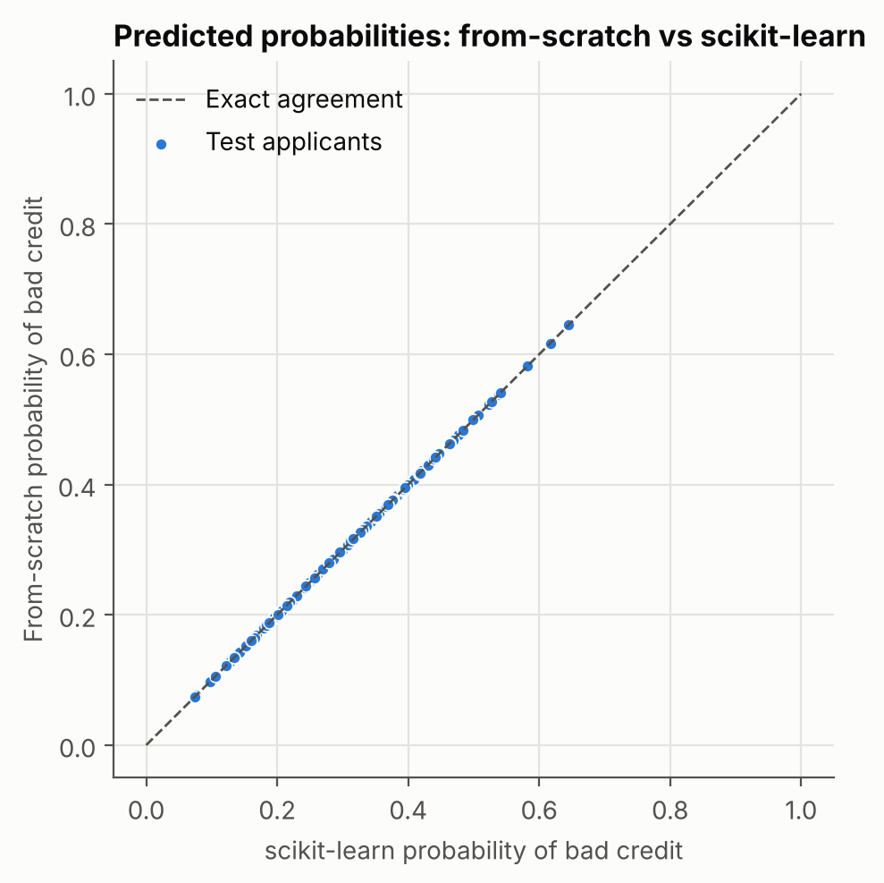
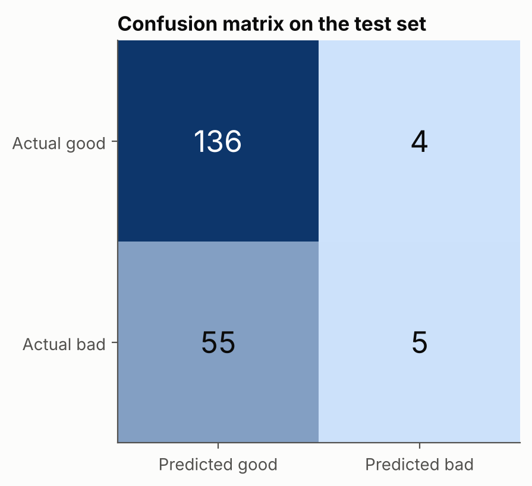
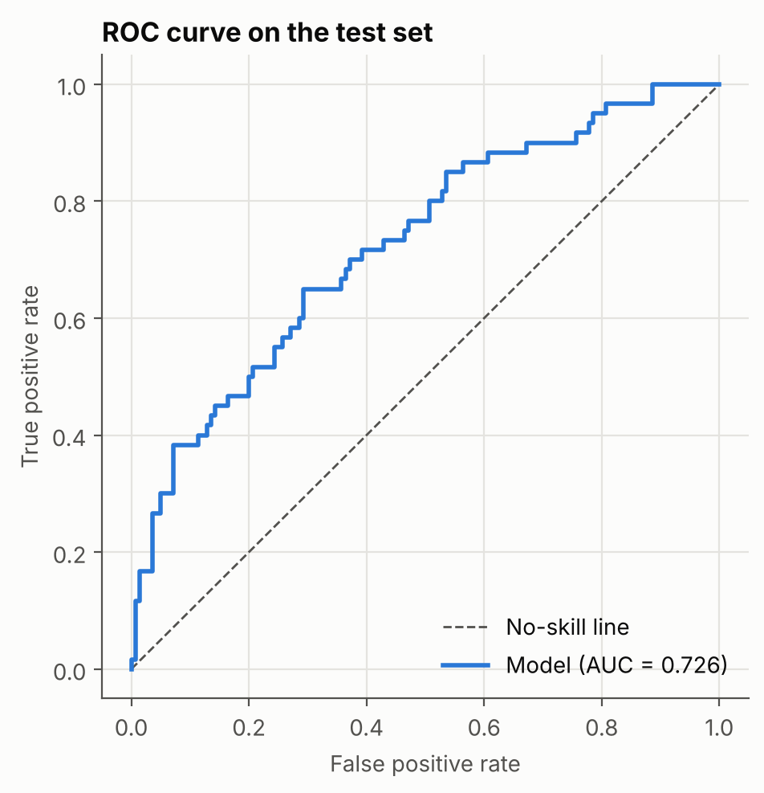

# Convergence Analysis of Gradient Descent for Credit Risk Prediction Using Logistic Regression

**M.Sc. Mathematics project — Vivekananda Global University (VGU), Jaipur**
**Author:** Jinson E B

Logistic Regression and Batch Gradient Descent are implemented from scratch in NumPy and used
to answer one question on real credit data:

> Do the mathematical properties of the loss function (its curvature and conditioning)
> actually predict how Gradient Descent behaves?

The short answer is yes. The largest Hessian eigenvalue predicts which learning rates are safe,
the smallest predicts how many iterations are needed, and feature scaling and regularisation
change the speed of convergence in the way the eigenvalues say they should.

## Contents

- [Key findings](#key-findings)
- [Set up and run](#set-up-and-run)
- [Dataset](#dataset)
- [Method](#method)
- [Results](#results)
- [Conclusions](#conclusions)
- [Limitations](#limitations)
- [Project structure](#project-structure)
- [References](#references)

## Key findings

| # | Finding | Evidence |
|---|---------|----------|
| 1 | Every learning rate below the theoretical ceiling 2/L = 1.46 decreased the loss at every step. | Experiment A |
| 2 | The ceiling is sufficient, not necessary. Rates of 2.0 and 2.5 still converged, because curvature near the solution (0.75) is lower than the global bound (1.37). A rate of 3.0 oscillated and never converged. | Experiment A |
| 3 | Doubling the learning rate halved the work: 10,128 iterations at η = 1.0, 5,063 at η = 2.0. | Experiment A |
| 4 | Feature scaling cut the condition number from 5.5 × 10⁹ to 1,381. The scaled problem converged in 13,887 iterations; the unscaled one was still far from the minimum after 20,000. | Experiment B |
| 5 | L2 regularisation with λ = 10 cut the condition number from 1,327 to 226 and iterations from 10,128 to 1,743, and raised test ROC-AUC from 0.726 to 0.745. | Experiment C |
| 6 | The from-scratch solution matches scikit-learn to about six decimal places and gives the same label for all 200 test applicants. | Experiment D |
| 7 | The final model reaches 73.5% test accuracy and a test ROC-AUC of 0.726. | Classification |

## Set up and run

Requires Python 3.10 or newer. The dataset is already in the repository, so nothing needs downloading.

```bash
# 1. Get the code
git clone https://github.com/FourAndHalf/credit-risk-gradient.git
cd credit-risk-gradient

# 2. Create and activate a virtual environment
python -m venv .venv
source .venv/bin/activate          # Linux / macOS
# .venv\Scripts\activate           # Windows

# 3. Install dependencies
pip install -r requirements.txt

# 4. Reproduce every table and figure (about 20 seconds)
python run_all_experiments.py
```

Step 4 writes:

- `results/figures/` — the 10 figures shown below
- `results/tables/` — 11 CSV tables
- `results/results_summary.md` — every table in one readable file

To walk through the work step by step instead, open the notebooks in order:

```bash
jupyter notebook notebooks/
```

| Notebook | What it covers |
|----------|----------------|
| `01_data_exploration.ipynb` | The dataset, class balance, distributions, the preprocessing pipeline |
| `02_mathematical_experiments.ipynb` | The four experiments, one at a time |
| `03_credit_risk_model.ipynb` | The final model, its diagnostics and classification performance |

## Dataset

**South German Credit** from the UCI Machine Learning Repository (Grömping, 2019), licence CC BY 4.0,
DOI [10.24432/C5X89F](https://doi.org/10.24432/C5X89F). The file `data/raw/SouthGermanCredit.asc`
is included unchanged.

- 1,000 loan applicants from 1973–1975, 20 predictors, one binary outcome, no missing values
- 700 good credits and 300 bad credits
- It is a corrected version of the widely used Statlog German Credit data, whose variable coding
  contained errors



| Numerical predictor | Meaning | Mean | Min | Max |
|---|---|---|---|---|
| `laufzeit` | Loan duration (months) | 20.9 | 4 | 72 |
| `hoehe` | Credit amount (DM) | 3,271 | 250 | 18,424 |
| `alter` | Age (years) | 35.5 | 19 | 75 |

The remaining predictors are categorical or ordinal codes (checking-account status, credit history,
purpose, savings, employment, housing, and so on). Full tables are in `results/tables/data_*.csv`.

**Preparation**

1. The outcome is recoded so that `y = 1` means bad credit, the event a lender wants to detect.
2. The data is split 80/20 (800 training, 200 test), stratified by class, with a fixed seed.
3. The 13 categorical predictors are one-hot encoded, dropping the first level of each.
4. The 7 numerical predictors are standardised using training-set statistics only.

This gives 48 feature columns plus an intercept: 49 parameters.

## Method

### Model and objective

For applicant *i* with features xᵢ, the predicted probability of bad credit is

```
pᵢ = σ(wᵀxᵢ + b),      σ(z) = 1 / (1 + e⁻ᶻ)
```

The parameters minimise the (optionally regularised) binary cross-entropy:

```
J(w, b) = −(1/m) Σ [ yᵢ ln pᵢ + (1 − yᵢ) ln(1 − pᵢ) ]  +  (λ / 2m) ‖w‖²
```

### Gradient and Hessian

```
∇w J = (1/m) Xᵀ(p − y) + (λ/m) w
H    = (1/m) Xᵀ W X + (λ/m) I,      W = diag( pᵢ(1 − pᵢ) )
```

The Hessian is positive semi-definite everywhere, so the loss is convex and any minimum is the
global one. Because pᵢ(1 − pᵢ) ≤ ¼, its largest eigenvalue never exceeds
`L = λmax(XᵀX) / 4m`, and that bound is reached exactly at the starting point w = 0.

### What theory predicts

| | Prediction |
|---|---|
| P1 | Any constant step η < 2/L decreases the loss at every iteration (a sufficient condition). |
| P2 | Near the solution, the error shrinks by at most ρ = max \|1 − η·λᵢ(H)\| per iteration. |
| P3 | Iterations to a fixed tolerance scale like 1/(η·μ), where μ is the smallest eigenvalue. |
| P4 | L2 regularisation adds λ/m to the eigenvalues, raising μ and lowering the condition number κ = λmax/λmin. |

### Algorithm

Batch Gradient Descent, written from scratch (`src/gradient_descent.py`):

1. Start at w = 0, b = 0.
2. Compute the loss and gradient over all 800 training rows.
3. Stop if the gradient norm is below 10⁻⁶, or after 20,000 iterations.
4. Update `w ← w − η ∇J` and repeat.

The loss and gradient norm are recorded at every iteration. scikit-learn is used only for
preprocessing utilities and as an independent check on the final answer.

### Experiments

| Experiment | Factor varied | Levels | Tests |
|---|---|---|---|
| A | Learning rate η | 0.001, 0.01, 0.1, 0.5, 1.0, 2.0, 2.5, 3.0, 4.0 | P1, P2, P3 |
| B | Feature scaling | Standardised vs raw, each at its own step size 1/L | Effect of κ |
| C | Regularisation λ | 0, 0.1, 1, 10, 100 | P3, P4 |
| D | Solver | From-scratch GD vs scikit-learn L-BFGS | Correctness |

## Results

### Curvature of the problem

| Quantity | Value |
|---|---|
| L, largest Hessian eigenvalue at the start | 1.3711 |
| Step-size ceiling 2/L | 1.459 |
| Largest eigenvalue at the solution | 0.7507 |
| Smallest eigenvalue at the solution (μ) | 0.00057 |
| Condition number at the solution | 1,326.9 |
| Minimum training loss | 0.431210 |

### Experiment A — learning rate

| η | η ÷ (2/L) | Iterations | Final loss | Final gradient norm | Predicted rate (worst case) | Observed rate | Status |
|---|---|---|---|---|---|---|---|
| 0.001 | 0.001 | 20,000 | 0.488044 | 3.98e-02 | 1.00000 | 0.99997 | Stable, tolerance not reached |
| 0.01 | 0.007 | 20,000 | 0.440840 | 7.04e-03 | 0.99999 | 0.99995 | Stable, tolerance not reached |
| 0.1 | 0.069 | 20,000 | 0.431400 | 5.60e-04 | 0.99994 | 0.99991 | Stable, tolerance not reached |
| 0.5 | 0.343 | 20,000 | 0.431210 | 1.10e-06 | 0.99972 | 0.99962 | Stable, tolerance not reached |
| 1.0 | 0.686 | 10,128 | 0.431210 | 1.00e-06 | 0.99943 | 0.99924 | Converged |
| 2.0 | 1.371 | 5,063 | 0.431210 | 9.99e-07 | 0.99887 | 0.99847 | Converged |
| 2.5 | 1.714 | 4,049 | 0.431210 | 9.99e-07 | 0.99859 | 0.99809 | Converged |
| 3.0 | 2.057 | 20,000 | 0.497594 | 2.73e-01 | > 1 | – | Unstable |
| 4.0 | 2.742 | 20,000 | 0.702002 | 4.36e-01 | > 1 | – | Unstable |







- All rates below the ceiling are stable, as P1 predicts. Very small rates are safe but
  impractical: at η = 0.001 the gradient norm is still 4 × 10⁻² after 20,000 iterations.
- Rates of 2.0 and 2.5 are above the ceiling yet converge. The ceiling uses the worst curvature
  anywhere (1.37); near the solution the curvature is 0.75, giving a local limit of about 2.66.
  Rates of 3.0 and 4.0 exceed that and oscillate.
- The observed contraction rate is never worse than the eigenvalue prediction, and moves towards
  it as the tolerance is tightened (0.99924 at 10⁻⁶, 0.99938 at 10⁻¹⁰ for η = 1.0).
- η × iterations stays at about 10,125 across the converged runs, as P3 predicts.

### Experiment B — feature scaling

| Quantity | Scaled | Unscaled |
|---|---|---|
| Largest eigenvalue L | 1.3711 | 4.689 × 10⁶ |
| Smallest eigenvalue | 0.00099 | 0.00085 |
| Condition number | 1,381 | 5.52 × 10⁹ |
| Step size used (1/L) | 0.729 | 2.13 × 10⁻⁷ |
| Loss after 1,000 iterations | 0.4331 | 0.6671 |
| Loss at stop | 0.4312 | 0.6181 |
| Iterations run | 13,887 | 20,000 |
| Status | Converged | Tolerance not reached |





- The smallest eigenvalue barely changes. Scaling removes a handful of huge eigenvalues created
  by raw-unit columns such as credit amount.
- Those large eigenvalues force a step size of about 2 × 10⁻⁷, so the flat directions hardly move
  and the unscaled run stalls.
- Scaling does not change the model, only the geometry the optimiser has to cross.

### Experiment C — L2 regularisation

| λ | Smallest eigenvalue | Condition number | Iterations | Weight norm | Training loss (unpenalised) | Test AUC |
|---|---|---|---|---|---|---|
| 0 | 0.00057 | 1,326.9 | 10,128 | 6.147 | 0.43121 | 0.7261 |
| 0.1 | 0.00063 | 1,198.2 | 8,914 | 5.725 | 0.43136 | 0.7280 |
| 1 | 0.00108 | 739.9 | 6,178 | 4.168 | 0.43547 | 0.7319 |
| 10 | 0.00413 | 225.8 | 1,743 | 2.076 | 0.46280 | 0.7452 |
| 100 | 0.02455 | 48.5 | 370 | 0.662 | 0.53076 | 0.7417 |



- Conditioning improves steadily with λ, driven by the rise in the smallest eigenvalue (P4).
- Fewer iterations are needed as μ rises (P3).
- The cost is training fit: the weights shrink and the unpenalised training loss rises.
- On the test set, moderate regularisation helps. AUC peaks at λ = 10, so the same setting
  improves both the optimisation and the generalisation.

### Experiment D — agreement with scikit-learn

| λ | Max coefficient difference | Max probability difference | Predicted labels that differ |
|---|---|---|---|
| 0 | 7.23 × 10⁻⁶ | 9.88 × 10⁻⁷ | 0 of 200 |
| 10 | 6.32 × 10⁻⁵ | 2.71 × 10⁻⁵ | 0 of 200 |



### Classification performance

| Set | Accuracy | Precision | Recall | F1 | ROC-AUC |
|---|---|---|---|---|---|
| Training | 0.7963 | 0.6954 | 0.5708 | 0.6270 | 0.8479 |
| Test | 0.7350 | 0.5745 | 0.4500 | 0.5047 | 0.7261 |

| Threshold | Accuracy | Precision | Recall | Bad loans caught | Good applicants refused |
|---|---|---|---|---|---|
| 0.3 | 0.685 | 0.482 | 0.650 | 39 of 60 | 42 of 140 |
| 0.4 | 0.710 | 0.517 | 0.517 | 31 of 60 | 29 of 140 |
| 0.5 | 0.735 | 0.575 | 0.450 | 27 of 60 | 20 of 140 |

 

- At the default threshold the model catches 27 of 60 bad loans and wrongly refuses 20 of 140
  good applicants.
- Lowering the threshold to 0.3 catches 39 of 60 bad loans at the cost of refusing 42 good
  applicants. Which threshold is right depends on the relative cost of the two errors.
- The gap between training AUC (0.848) and test AUC (0.726) shows some overfitting, which is
  why regularisation helps in Experiment C.

## Conclusions

1. **The theory holds on real data.** All four predictions were confirmed, in most cases
   quantitatively.
2. **The step-size ceiling 2/L is safe but conservative.** The true limit is set by the curvature
   along the path, which on this problem allows steps up to about 1.8 times the ceiling.
3. **Feature scaling is a requirement, not a nicety.** It improves the condition number by more
   than six orders of magnitude and is the difference between converging and stalling.
4. **Regularisation does two jobs.** It improves conditioning in a predictable way and, at
   moderate strength, improves test performance.
5. **A simple first-order method reaches the same answer as an industrial solver**, given a
   well-conditioned problem and enough iterations.

## Limitations

- Only constant-step Batch Gradient Descent is studied; momentum, adaptive and second-order
  methods are not.
- The dataset is small (1,000 rows) and old (1973–1975), and bad credits were oversampled, so
  the classification figures say nothing about modern lending.
- Results come from a single train/test split with one seed; the classification metrics would
  vary with a different split.
- The exact Hessian is practical here because there are only 49 parameters.
- Fairness and regulatory questions are outside the scope. One predictor encodes sex and
  marital status, and another flags foreign workers.

## Project structure

```
credit-risk-gradient/
├── run_all_experiments.py        # Reproduces every table and figure
├── requirements.txt
├── data/raw/SouthGermanCredit.asc
├── src/
│   ├── data_preparation.py       # Loading, encoding, scaling, splitting
│   ├── logistic_regression.py    # Sigmoid, loss, gradient, Hessian
│   ├── gradient_descent.py       # Batch Gradient Descent with full history
│   ├── evaluation.py             # Metrics and scikit-learn comparison
│   └── visualization.py          # Plot helpers used by the notebooks
├── notebooks/                    # Step-by-step walkthroughs
├── results/
│   ├── figures/                  # 10 PNG figures
│   ├── tables/                   # 11 CSV tables
│   └── results_summary.md
└── report/dissertation.md        # Chapter outline
```

## References

- Boyd, S. and Vandenberghe, L. (2004). *Convex Optimization*. Cambridge University Press.
- Nocedal, J. and Wright, S. J. (2006). *Numerical Optimization*, 2nd ed. Springer.
- Bishop, C. M. (2006). *Pattern Recognition and Machine Learning*. Springer.
- Hastie, T., Tibshirani, R. and Friedman, J. (2009). *The Elements of Statistical Learning*, 2nd ed. Springer.
- Grömping, U. (2019). *South German Credit Data: Correcting a Widely Used Data Set*. Beuth University of Applied Sciences Berlin. Dataset: https://doi.org/10.24432/C5X89F

## Licence

Code: MIT (see `LICENSE`). Dataset: CC BY 4.0, credited to the UCI Machine Learning Repository
and U. Grömping.
